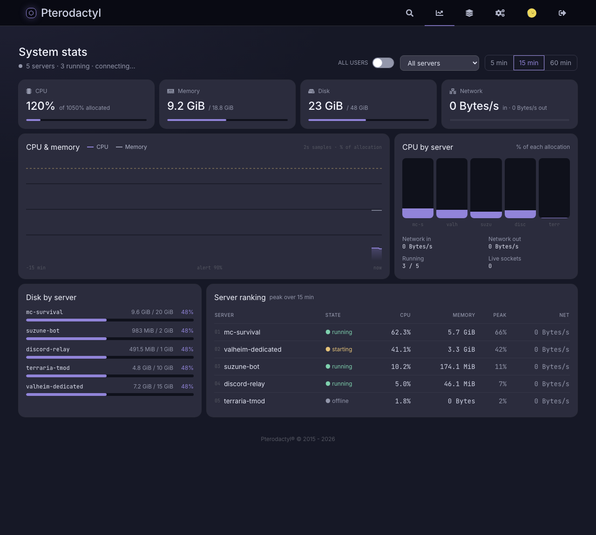

# Pterodactyl Nocturne

A dark, quiet reskin for an existing [Pterodactyl](https://pterodactyl.io) panel (1.11 through 1.15), based on the Nocturne design system: a blue-grey ground, Inter at medium weight, soft 8px corners, and a blurple accent used as a line and a glow rather than a flood.

Apart from one read-only **System stats** page, it's cosmetic: there are no database migrations and no backend changes, and it can be removed with one command.




## What changes

| Area | Change |
| --- | --- |
| Client panel | The whole Tailwind palette is swapped for Nocturne's: page, cards, inputs and the top bar move to the blue-grey ramp, and every blue/cyan accent becomes the Nocturne accent. Inter replaces IBM Plex/Rubik, JetBrains Mono is used for code and the console. The page gets a faint accent glow, and server rows get a hairline edge with an accent glow on hover. |
| Login | The white login card becomes a dark surface with dark inputs. |
| Console | xterm gets a matching colour scheme (Nocturne, Dracula or Tokyo Night). |
| System stats | A new page at `/stats`, opened from the chart icon in the top bar. It shows live CPU, memory, disk and network totals across your servers, a CPU and memory chart over the last 5, 15 or 60 minutes, CPU by server, disk by server, and a server ranking. Root admins can switch it to include every user's servers. |
| Admin area | AdminLTE is reskinned with a dark sidebar, surface boxes, outlined buttons, dark forms, select2 and tables. |

## Install

On the panel host, as root:

```bash
git clone https://github.com/hrxshxx/pterodactyl-nocturne.git /opt/pterodactyl-nocturne
cd /opt/pterodactyl-nocturne
./install.sh /var/www/pterodactyl
```

Then hard-refresh the panel (Ctrl/Cmd+Shift+R).

The installer needs **Node.js 16 or newer** (it installs `yarn` for you if it's missing). On Debian/Ubuntu you can get Node with:

```bash
curl -fsSL https://deb.nodesource.com/setup_20.x | bash - && apt-get install -y nodejs
```

The build runs webpack, which wants about 2 GB of RAM. On a small VPS, add swap first. The panel stays online during the build because the new bundle only takes over once it's finished.

### What the installer touches

It backs up and patches six files, adds one, then rebuilds the frontend:

- `tailwind.config.js`: regenerated with the Nocturne palette, fonts and radii
- `resources/scripts/components/server/console/Console.tsx`: the terminal colour block only
- `resources/views/templates/wrapper.blade.php`: fonts and `/themes/nocturne/nocturne.css`
- `resources/views/layouts/admin.blade.php`: fonts and `/themes/nocturne/admin.css`
- `resources/scripts/routers/DashboardRouter.tsx`: the `/stats` route
- `resources/scripts/components/NavigationBar.tsx`: the System stats icon
- adds `resources/scripts/components/nocturne/SystemStatsContainer.tsx`: the stats page itself

Pristine copies go in `<panel>/.nocturne-backup/`, and the stylesheets go in `<panel>/public/themes/nocturne/`.

## Customise

Edit `nocturne.config.json`, then run `./install.sh` again:

```json
{
    "accent": "#9184d9",
    "background": "#161826",
    "surfaceTint": 30,
    "radius": "default",
    "consoleScheme": "nocturne",
    "statsPage": true
}
```

| Key | Values |
| --- | --- |
| `accent` | Any 6-digit hex. The full ramp is derived from it, and the installer warns if it's below 3:1 contrast on the background. Presets from the design: Violet `#8b5cf6`, Indigo `#6366f1`, Fuchsia `#d946ef`, Cyan `#22d3ee`, Emerald `#34d399`. |
| `background` | Page colour (6-digit hex). Cards, inputs and the top bar are derived from it. |
| `surfaceTint` | 0–100. How much of the accent tints the card surfaces. |
| `radius` | `sharp`, `default` or `rounded` |
| `consoleScheme` | `nocturne`, `dracula` or `tokyo` |
| `statsPage` | `true` or `false`. Whether to add the System stats page. |

## How System stats stays live

The page only uses what the panel already exposes, so nothing extra runs on your nodes. For each server it opens the same Wings websocket the console uses, which pushes a stats frame every couple of seconds. Totals and the chart update every 2 seconds.

- Up to 40 servers stream live. Any beyond that, or any whose socket can't connect (for example a subuser without console access), fall back to the panel's `/resources` endpoint every 20 seconds, which is as fresh as the panel's own cache allows.
- Percentages are of what each server is allocated in the panel. A server with no CPU limit counts as 100%.
- History lives in the browser tab, so the chart starts empty and fills as you watch. It isn't stored anywhere.
- It shows per-server usage, not the host's own CPU cores, load or mounts. Pterodactyl doesn't expose those without an agent on the node.

## Updating Pterodactyl

A panel upgrade overwrites the patched files, so the panel goes back to its stock look. Run `./install.sh` again afterwards. It notices the new upstream files, refreshes its backups from them, and re-applies the theme.

## Uninstall

```bash
cd /opt/pterodactyl-nocturne
./uninstall.sh /var/www/pterodactyl
```

This restores the original files from `.nocturne-backup/`, deletes `public/themes/nocturne/` and the stats page, and rebuilds.

## Notes

- Built and tested against Pterodactyl **v1.11.11** and **v1.15.1**. The installer warns on other versions. If a file it patches doesn't look like upstream, it stops before writing anything.
- The design mockup in [`design/`](design/) also sketches a left sidebar layout, a container console with an audit log, and a per-user Personalisation screen. Those aren't included. The Personalisation choices are available install-wide through `nocturne.config.json`.
- Panel selectors that target upstream components use the readable part of styled-components class names (for example `ServerRow__StatusIndicatorBox-`), which upstream's build keeps. If a future panel version renames a component, that one tweak stops applying, but the palette still works.
